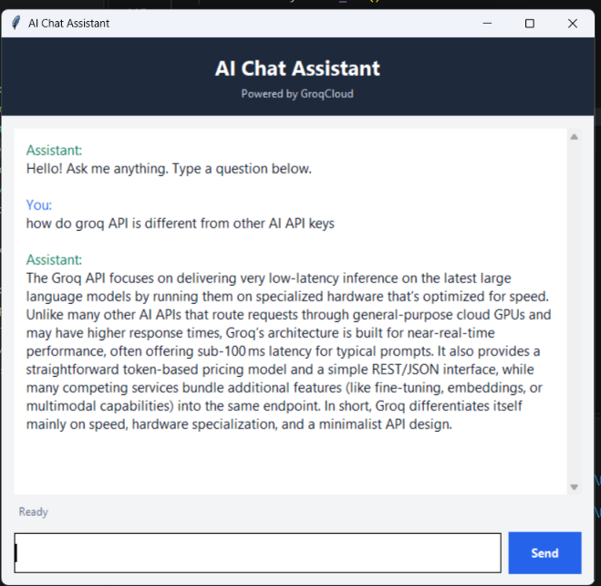

# Task 1 - Groq AI Chatbot

Task 1 is a desktop chatbot written in Python. It uses Tkinter for its graphical
interface and the Groq API to generate answers to questions. The conversation
stays visible in the window while the program is running, so you can ask
follow-up questions.

## Project files

- `Chat-bot.py` - Creates the Tkinter chat window, accepts questions, calls the
  Groq API, and displays answers and errors.
- `pyproject.toml` - Project metadata, Python requirement, and package
  dependencies for `uv`.
- `uv.lock` - Locked package versions generated by `uv`.
- `.python-version` - Selects Python 3.11 for this project.
- `.gitignore` - Excludes virtual environments and generated Python files.

## Application screenshot

The screenshot below shows the Task 1 chatbot interface:



## Requirements

- Windows with Python 3.11 or newer.
- `uv` to install dependencies using the project configuration and lock file.
- A Groq account and API key.
- Internet access while sending prompts to Groq.
- Tkinter, which is included with most standard Windows Python installations.

The Python dependencies declared by this project are `groq` and
`python-dotenv`. Tkinter is part of Python's standard library on Windows and
is not installed through `pyproject.toml`.

## 1. Open the Task 1 folder

Open PowerShell and change to the project directory. Use quotes because the
parent folder name contains an apostrophe:

```powershell
Set-Location -LiteralPath "C:\Users\Harsh_Kumar\Desktop\GENAI'\Week 2\Task 1"
```

Run the following commands from this folder unless otherwise noted.

## 2. Configure the Groq API key

The program reads its configuration from the shared `.env` file in the parent
`Week 2` folder:

```text
Week 2\.env
```

That file should contain a Groq API key and may optionally specify a model:

```dotenv
GROQ_API_KEY=your_groq_api_key_here
GROQ_MODEL=openai/gpt-oss-120b
```

- `GROQ_API_KEY` is required. Replace the example value with your own key.
- `GROQ_MODEL` is optional. If omitted, the program uses
  `openai/gpt-oss-120b`.

The application finds this file relative to `Chat-bot.py`, so it does not
depend on the current working directory. A `.env` file placed only inside
`Task 1` will not be used by the current code.

Keep the key private. Do not paste it into the Python file, publish it in a
repository, or include it in screenshots. If it is exposed, revoke it with
Groq and create a replacement.

If `GROQ_API_KEY` is missing, the program stops with a clear error before
opening the chat window.

## 3. Install dependencies

### Recommended: use `uv`

Install `uv` if it is not already available, then run:

```powershell
uv sync
```

`uv sync` reads the project dependencies from `pyproject.toml` and uses
`uv.lock` to install the locked versions into the project's virtual
environment.

### Alternative: use Python and pip

If you are not using `uv`, create and activate a virtual environment:

```powershell
py -3.11 -m venv .venv
.\.venv\Scripts\Activate.ps1
python -m pip install --upgrade pip
python -m pip install groq python-dotenv
```

If PowerShell blocks virtual-environment activation, invoke its Python
executable directly:

```powershell
.\.venv\Scripts\python.exe -m pip install groq python-dotenv
```

## 4. Start the chatbot

With `uv`, run:

```powershell
uv run python Chat-bot.py
```

Or, if the virtual environment is activated, run:

```powershell
python Chat-bot.py
```

The application opens a window titled **AI Chat Assistant**. Type a question
in the input field at the bottom and press **Enter** or click **Send**. The
assistant's answer appears in the conversation area. Type another question to
continue the conversation; close the window to exit.

## How the application works

### Window and conversation

`Chat-bot.py` creates the window and its widgets using Tkinter:

- A header identifies the application.
- A scrollable, read-only area displays the conversation.
- A text input field accepts a question.
- A Send button submits the question.
- A status label shows whether the assistant is ready, thinking, or has failed.

The chat history is stored in memory. Each successful exchange is included in
later requests to give the model context for follow-up questions. Closing the
application clears that history; it is not written to a file or database.

### Sending a question

When a non-empty question is submitted, the app clears the input field and
shows the user's message immediately. It then disables the Send button and
updates the status while a background thread makes the API request. Running
the network request in a background thread helps keep the window responsive.

The request contains a system instruction to answer directly and concisely,
the earlier conversation history, and the current question. The request uses
the configured model and allows up to 800 generated tokens. The API's returned
text is displayed as the assistant's message.

### Errors

The application handles common API failures and displays a message in the
conversation:

- Rate limits: wait before trying again.
- Connection failures: check internet access.
- Other HTTP status errors: verify the model, API key, and account access.
- Unexpected errors: the application displays the error text for diagnosis.

After the response or error is shown, the status is updated and the Send button
is enabled again.

## Troubleshooting

### `GROQ_API_KEY is missing`

Check that `GROQ_API_KEY` is set in `Week 2\.env` and that the file is saved.
The key must not be empty. The Task 1 program loads the `.env` from the Week 2
parent folder, not from the Task 1 folder.

### Model not found or access denied

Confirm that the configured `GROQ_MODEL` is available to your Groq account. If
the setting is absent, the code requests `openai/gpt-oss-120b`.

### `ModuleNotFoundError` for `groq` or `dotenv`

Install the packages into the same Python environment used to launch the app:

```powershell
uv sync
```

Or, in an activated environment:

```powershell
python -m pip install groq python-dotenv
```

In VS Code, select the matching project Python environment if the editor uses
a different interpreter.

### Tkinter window does not open

Check that Tkinter is installed and available to the selected Python:

```powershell
python -m tkinter
```

On Windows, use a standard desktop Python installation that includes Tkinter.

### Request fails after the window opens

Check the internet connection, API key, selected model, and Groq account
limits. The application displays request errors in the chat window.

## Privacy and usage notes

- The API key is used to authenticate requests to Groq; do not expose it.
- Prompts and the conversation history are sent to the Groq API to generate
  answers. Avoid entering passwords, API keys, or other sensitive information.
- API requests may be subject to provider rate limits or charges.
- The application keeps conversation history in memory only and does not save
  it after the window closes.