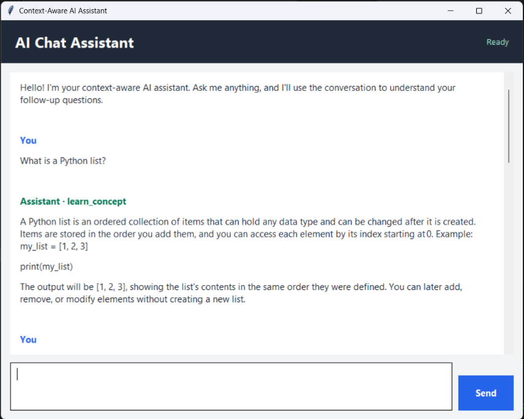

# Task 2 - Context-Aware AI Assistant

This project is a Python chatbot powered by the Groq API. It can classify a
message by intent, use recent conversation messages to understand follow-up
questions, and generate a concise answer.

There are two ways to use it:

1. `chat_app.py` opens a desktop graphical interface with a chat history,
   multiline question box, and Send button.
2. `context_assistant.py` runs an interactive chatbot in a terminal.

Both programs use the same assistant logic from `context_assistant.py`.

## Contents

- `chat_app.py` - Tkinter desktop chat application.
- `context_assistant.py` - Configuration, intent detection, response generation,
  and terminal chat loop.
- `ScreenshotOfChatBot.png` - Screenshot of the graphical application.
- `.gitignore` - Ignores Python cache, build, and virtual-environment files.

## Application screenshot

The screenshot below shows the desktop chat interface provided by
`chat_app.py`:



## Requirements

- Python 3.10 or newer. The source uses Python 3.10 type-hint syntax.
- A Groq account and API key.
- Internet access for requests to the Groq API.
- The Python packages `groq` and `python-dotenv`.
- Tkinter for the graphical interface. Tkinter is usually included with the
  standard Windows Python installer.

## 1. Open the project folder

In PowerShell, change to this folder (keep the quotes because the parent path
contains an apostrophe):

```powershell
Set-Location -LiteralPath "C:\Users\Harsh_Kumar\Desktop\GENAI'\Week 2\Task 2"
```

The examples below assume PowerShell is open in the Task 2 folder.

## 2. Create and activate a virtual environment

Creating a virtual environment keeps this project's packages separate from
other Python projects:

```powershell
py -m venv .venv
.\.venv\Scripts\Activate.ps1
```

If PowerShell prevents activation because of its execution policy, you can
still use the virtual environment's Python executable directly:

```powershell
.\.venv\Scripts\python.exe -m pip install groq python-dotenv
```

Otherwise, install the required packages after activating the environment:

```powershell
python -m pip install --upgrade pip
python -m pip install groq python-dotenv
```

To check Tkinter separately, run:

```powershell
python -m tkinter
```

If Tkinter is available, a small test window should appear. Close it to
continue.

## 3. Configure the Groq API

The application reads its configuration from the shared file:

```text
Week 2\.env
```

In the current project layout, this is the file one folder above `Task 2`.
`context_assistant.py` loads it using its own file location, so launching the
application from a different working directory does not change which shared
file it reads.

Add these entries to `Week 2\.env`:

```dotenv
GROQ_API_KEY=your_groq_api_key_here
GROQ_MODEL=openai/gpt-oss-120b
```

- `GROQ_API_KEY` is required. Replace the example text with your own key.
- `GROQ_MODEL` is optional. If omitted, the code uses
  `openai/gpt-oss-120b`.

Do not put quotation marks around the values unless they are actually part of
the value. Do not share or commit the API key. If a key is exposed, revoke it
with the provider and create a replacement.

> **Important:** A `.env` file inside `Task 2` is not loaded by the current
> code. The code explicitly loads `Week 2\.env`. Keep the configuration there
> or update the code if you intentionally want to use a different location.

## 4. Run the desktop chat application

From PowerShell in the Task 2 folder:

```powershell
python chat_app.py
```

The window has a scrollable conversation area and a text box at the bottom.

- Type a question in the bottom box and press **Enter** or click **Send**.
- Press **Shift+Enter** to add a new line without sending the message.
- The Send button is disabled while a request is being processed.
- The header displays the current status, such as `Ready` or `Thinking...`.
- The assistant's intent category appears alongside its response.

The Groq calls run on a background thread. A queue passes the completed
response back to the Tkinter main thread so that the window remains responsive.

### What `chat_app.py` does

`chat_app.py` is the desktop front end. It builds the Tkinter window, displays
the conversation, accepts questions, and calls the shared assistant functions
in `context_assistant.py`.

When you send a non-empty message, the app displays it immediately, marks the
status as `Thinking...`, and disables the Send button to prevent overlapping
requests. A background worker calls the intent detector and response generator.
It places the result in a thread-safe queue; the Tkinter event loop checks that
queue, adds the assistant's response (or an error) to the chat, restores the
`Ready` status, and enables Send again. This keeps the interface usable while
the network request is running.

The chat history is kept in memory for the current app session and is supplied
to the assistant to help interpret follow-up questions. The text box supports
multiple lines: Enter sends the message, while Shift+Enter inserts a newline.

## 5. Run the terminal chatbot

To use the command-line version instead:

```powershell
python context_assistant.py
```

Type a message at the `You:` prompt. Type `exit` to close the program. The
terminal version prints the detected intent and the assistant's response.

To start either application from a different folder, pass the script's full
path to Python. The shared `.env` location is based on the script path, not
the current folder.

## How the assistant works

### Configuration

At startup, `context_assistant.py` loads `GROQ_API_KEY` and the optional
`GROQ_MODEL` setting, then creates a Groq client. If the API key is missing,
startup stops with an error rather than making an unauthenticated request.

### Intent categories

Each new message is assigned one of these categories:

- `learn_concept` - explanations, tutorials, learning questions, or examples.
- `data_analysis` - analyzing data or finding trends and insights.
- `data_cleaning` - cleaning, deduplicating, or validating data.
- `summarization` - summarizing supplied information.
- `planning` - creating plans or roadmaps.
- `general_question` - other questions.

`detect_rule_based_intent()` first checks for common phrases using regular
expressions. If it cannot confidently assign a category, `detect_intent()`
sends the message and recent conversation context to the configured Groq
model for classification. If the model returns an unexpected category, the
code falls back to `general_question`.

### Response generation and context

`generate_response()` builds a system prompt from the user's configured
context summary, the detected intent, and that intent's instructions. It
then sends the current question and recent user/assistant messages to Groq.
The response prompt asks for concise, beginner-friendly replies and uses
`INTENT_INSTRUCTIONS` to tailor the answer to the category.

Conversation history is kept in memory while the program is running:

- Intent classification can use the last six messages.
- Response generation can use the last ten messages.
- Individual historical messages are truncated to limit the amount of context
  sent to the API.
- Only successful user/assistant exchanges are added to history.
- Closing and restarting the application clears its in-memory history.

The assistant does not save the conversation to a file or database.

### GUI request flow

`chat_app.py` calls `detect_intent()` and `generate_response()` from
`context_assistant.py`. It sends API work to a worker thread, then uses a
thread-safe queue and Tkinter's event loop to display the result and re-enable
the Send button.

## Troubleshooting

### `GROQ_API_KEY is missing`

Confirm that `GROQ_API_KEY` is set in `Week 2\.env`, spelled exactly as shown,
and has a value. Remember that a Task 2-local `.env` file is not loaded by the
current code.

### Model not found or no access

Check that `GROQ_MODEL` names a model currently available to your Groq
account. If it is unset, the application requests `openai/gpt-oss-120b`.

### `ModuleNotFoundError: No module named 'groq'` or `'dotenv'`

Activate the project's virtual environment and install the dependencies:

```powershell
python -m pip install groq python-dotenv
```

Make sure VS Code is using the same Python environment in which you installed
the packages.

### The graphical window does not open

Run `python -m tkinter` to check whether Tkinter is installed. Also confirm
that you ran `chat_app.py` with a desktop-enabled Python installation.

### The window opens but the request fails

Check your internet connection, API key, model access, and Groq account limits.
The GUI displays request failures in the conversation window; the terminal
version prints the failure after `Request failed:`.

## Security and cost notes

- Keep `.env` private. Never paste an API key into source code, screenshots,
  chat messages, or a public repository.
- Each successful message may make one API request for intent classification
  and another for response generation. Messages recognized by the
  rule-based classifier skip the classification API request.
- API usage may count toward your provider's limits or billing.
- Conversation history is sent to the model to support follow-up questions;
  avoid entering secrets or sensitive personal information.
