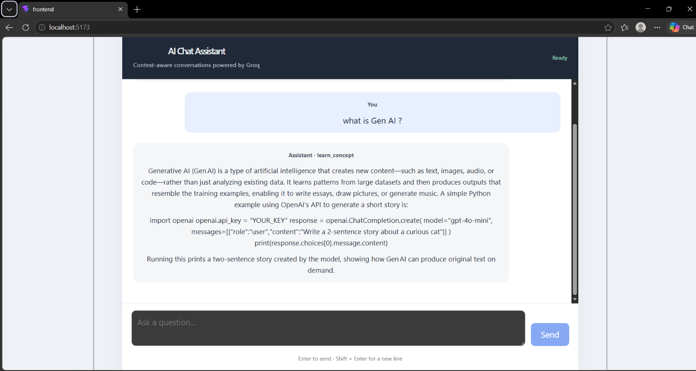

# Task 3 - Context-Aware AI Chat Assistant

Task 3 is a context-aware AI chat assistant powered by the Groq API. It can be
used in a browser through a React frontend and Flask backend, or as a separate
Tkinter desktop application. Both interfaces share the assistant module that
classifies questions and generates responses.

## Screenshots

The screenshot below shows the browser interface rendering formatted
assistant responses:



## Project structure

- `server.py` - Flask API server. Provides the `/api/chat` endpoint and keeps
  conversation history in memory.
- `context_assistant.py` - Loads Groq configuration, detects intent, and
  generates context-aware answers.
- `chat_app.py` - Optional Tkinter desktop chat interface. It calls the shared
  assistant functions directly and does not need the Flask server or React
  frontend.
- `main.py` - Small project placeholder that prints `Hello from task-3!`; it
  does not launch the chat app.
- `pyproject.toml` - Python project metadata, Python requirement, and backend
  dependencies.
- `uv.lock` - Locked Python dependency versions for `uv`.
- `.python-version` - Selects Python 3.11.
- `.env` - Local environment file present in this folder. Note: the current
  assistant code does not load this file; see
  [Configure Groq](#2-configure-groq).
- `.gitignore` - Ignores common Python-generated files and virtual
  environments.
- `frontend/` - React and Vite web application.
  - `src/App.jsx` - Chat interface, input handling, API requests, and message
    rendering.
  - `src/App.css` and `src/index.css` - Chat-specific and global styles.
  - `src/main.jsx` - Mounts the React application in the page.
  - `index.html` - Browser page template.
  - `vite.config.js` - Vite development server configuration and API proxy.
  - `package.json` and `package-lock.json` - Frontend dependencies and
    scripts.
- `ScreenshotReact-Markdown.png` - Browser interface screenshot included
  above.

## Requirements

- Windows, macOS, or Linux.
- Python 3.11 or newer.
- `uv` for installing the Python backend dependencies.
- Node.js and npm for installing and running the frontend.
- A Groq account and an API key.
- Internet access for requests to the Groq API.
- Tkinter for the optional desktop interface. Tkinter is normally included
  with standard Windows Python installations.

## 1. Open the project folder

In PowerShell, change to the Task 3 directory. The quotes are needed because
the parent folder name contains an apostrophe:

```powershell
Set-Location -LiteralPath "C:\Users\Harsh_Kumar\Desktop\GENAI'\Week 2\Task 3"
```

The commands below assume PowerShell is open in this folder.

## 2. Configure Groq

The backend code loads its `.env` file from the parent `Week 2` folder. It
does **not** currently load `Task 3\.env`. Configure the shared file here:

```text
Week 2\.env
```

It should contain:

```dotenv
GROQ_API_KEY=your_groq_api_key_here
GROQ_MODEL=openai/gpt-oss-120b
```

- `GROQ_API_KEY` is required. Replace the example with your own Groq API key.
- `GROQ_MODEL` is optional. If omitted, the backend defaults to
  `openai/gpt-oss-120b`.

Keep the key private. Do not paste it into source code, screenshots, chat
messages, or a public repository. The `.env` currently present inside Task 3
is not read by the assistant code; avoid putting secrets there unless you
first change the loading path. The Task 3 `.gitignore` does not currently
exclude `.env`, so do not add a local `.env` containing secrets to version
control.

If the API key is missing, importing `context_assistant.py` fails with a
configuration error, and the Flask server will not start.

## 3. Install backend dependencies

From the Task 3 folder, run:

```powershell
uv sync
```

This reads the Python dependencies from `pyproject.toml`, uses `uv.lock` to
resolve locked versions, and creates or updates the project's virtual
environment.

The backend dependencies include:

- `flask` - HTTP API server.
- `groq` - Groq API client.
- `python-dotenv` - Loads environment variables from the configured `.env`.

## 4. Install frontend dependencies

Open a terminal in the frontend folder:

```powershell
Set-Location -LiteralPath "C:\Users\Harsh_Kumar\Desktop\GENAI'\Week 2\Task 3\frontend"
npm ci
```

`npm ci` installs the exact frontend dependency versions recorded in
`package-lock.json`. The frontend uses React, Vite, `react-markdown`, and
`remark-gfm`.

## 5. Start the app

The frontend and backend are separate development servers. Start each in its
own terminal, and leave both terminals running.

### Terminal 1: Flask backend

From the Task 3 folder:

```powershell
Set-Location -LiteralPath "C:\Users\Harsh_Kumar\Desktop\GENAI'\Week 2\Task 3"
uv run python server.py
```

The Flask server listens on `http://127.0.0.1:5000`.

### Terminal 2: React frontend

From the frontend folder:

```powershell
Set-Location -LiteralPath "C:\Users\Harsh_Kumar\Desktop\GENAI'\Week 2\Task 3\frontend"
npm run dev
```

Vite prints a local development URL in the terminal, typically
`http://localhost:5173`. Open that URL in a browser. Keep the Flask backend
running as well: Vite forwards requests beginning with `/api` to
`http://127.0.0.1:5000`.

### Optional: Tkinter desktop app

To use the desktop chat window instead of the browser version, open another
terminal in the Task 3 folder and run:

```powershell
Set-Location -LiteralPath "C:\Users\Harsh_Kumar\Desktop\GENAI'\Week 2\Task 3"
uv run python chat_app.py
```

This interface calls `detect_intent()` and `generate_response()` directly.
It does not use Flask, Vite, or the browser. Type a question in the text box
and press **Enter** or click **Send**; **Shift+Enter** inserts a newline. The
chat history stays in memory until the window closes.

## Using the chat

- Enter a question in the text box and press **Enter** or click **Send**.
- Press **Shift+Enter** to insert a newline.
- The interface displays a thinking indicator while the server is responding.
- Assistant responses support Markdown, including GitHub-flavored Markdown
  tables and lists.
- The latest assistant response can show its detected intent category.
- Errors from the API are shown in the conversation.

## How a message is processed

1. `frontend/src/App.jsx` adds the user's message to the interface and sends a
   JSON `POST` request to `/api/chat`.
2. During local development, Vite proxies `/api` requests to the Flask server.
3. `server.py` validates the message and uses the conversation ID to look up
   that conversation's history.
4. `context_assistant.py` first checks common requests with rule-based intent
   detection. If no rule matches, it asks the configured model to classify the
   message using recent conversation context.
5. The backend builds a response prompt from the intent, instructions, user
   context summary, recent conversation, and current message, then requests an
   answer from Groq.
6. The backend saves the successful exchange in that conversation's history
   and returns JSON containing the conversation ID, intent, and answer.
7. The React app displays the response, rendering assistant content as
   Markdown.

## API endpoint

The Flask backend exposes:

```text
POST /api/chat
Content-Type: application/json
```

Example request body:

```json
{
  "message": "Explain Python lists with an example.",
  "conversation_id": ""
}
```

The first successful request creates a conversation ID. The frontend sends
that ID with follow-up questions so the backend can use the corresponding
history. A successful response contains `conversation_id`, `intent`, and `answer`.
Empty messages, messages longer than 10,000 characters, and non-string
conversation IDs return a client error. A failed AI request is logged by
Flask and returned as a generic server error.

## Conversation storage and limits

Conversation history is held in the Flask process's memory:

- History is separated by conversation ID.
- The frontend keeps its conversation ID in React state for the current page
  session.
- Restarting the Flask server clears all conversations.
- Reloading the page resets the frontend state and starts a new conversation.
- Conversations are not saved to a database or file.

The API rejects empty messages and messages longer than 10,000 characters.
Intent detection uses up to six earlier messages; response generation uses up
to ten. Historical message content is truncated before it is sent to the
model.

## Helpful frontend commands

Run these from the `frontend` folder:

```powershell
npm run lint
npm run build
npm run preview
```

- `npm run lint` checks frontend source with Oxlint.
- `npm run build` creates a production build in `frontend/dist/`.
- `npm run preview` serves the built frontend for local preview. The Flask API
  must also be running for chat requests.

## Troubleshooting

### `GROQ_API_KEY` is missing

Check that `GROQ_API_KEY` is set in `Week 2\.env` and that the file is saved.
The current backend loads that parent-folder file, not `Task 3\.env`.

### Model not found or no access

Check that `GROQ_MODEL` is available to your Groq account. If it is absent,
the backend uses `openai/gpt-oss-120b`.

### Frontend cannot contact the assistant

Confirm the Flask terminal is still running on `127.0.0.1:5000` and that the
frontend was started with `npm run dev`. The Vite proxy is configured in
`frontend/vite.config.js`.

### `ModuleNotFoundError` in the backend

From Task 3, run:

```powershell
uv sync
```

Then start the backend with `uv run python server.py`.

### `npm` or Node.js is not found

Install Node.js with npm, open a new terminal, and confirm `node` and `npm`
are available on the command line. Then run `npm ci` inside `frontend`.

### The page loads but styles or chat behavior look stale

Restart the Vite development server and reload the page. If necessary, stop
the frontend server, run `npm ci` again from `frontend`, and restart it.

## Security, privacy, and cost

- Never commit or expose the Groq API key.
- User messages and recent conversation history are sent to Groq to produce
  answers. Do not enter passwords, credentials, or sensitive information.
- The in-memory Flask conversation dictionary is intended for a local demo;
  it has no persistence and is not designed as production-grade storage.
- A message may require one model request for intent classification and
  another for answer generation. Clear requests handled by the rule-based
  classifier skip the classification request.
- API usage may be subject to Groq rate limits or charges.
